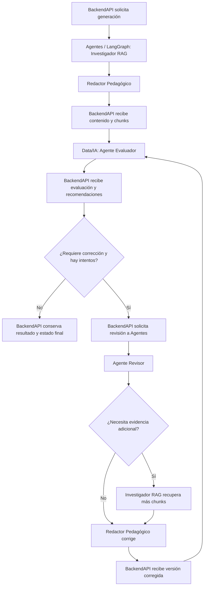
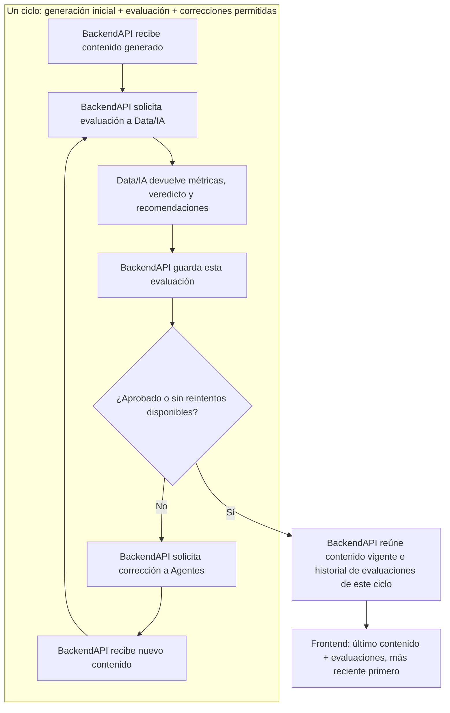

# NuevaMente — Planning y definición funcional del Sprint 4

> **Documento de trabajo — versión 2 (12 de octubre de 2026).** Actualiza el planning de Sprint 4 con los acuerdos funcionales y las decisiones de arquitectura discutidas posteriormente, además de los hallazgos del código examinado en la rama `QA`. **No certifica implementación ni sustituye la validación de contratos y soluciones por los equipos.**

## 1. Propósito y contexto

Sprint 4 concentra el cierre e integración del producto educativo NuevaMente: generación de contenido adaptado mediante RAG, evaluación de calidad, revisión/corrección guiada por recomendaciones y preparación de pruebas y demostración final. El proyecto trabaja con las áreas **Agentes, BackendAPI, Data/IA, Frontend y QA**.

Se busca conservar el MVP ya construido y añadir el diferencial **multiagente con LangGraph**, sin reconstruir componentes que funcionan. La gestión del sprint debe priorizar el circuito completo y demostrable por encima de incorporar capacidades accesorias.

**Fuentes de referencia:** [repositorio del equipo](https://github.com/No-Country-simulation/G10-LATAM-EQUIPO-7-NUEVAMENTE), rama `QA`; [tablero Trello](https://trello.com/b/sfLjGWmk/nuevamente-g10-latam-e7); revisión de código y acuerdos de esta conversación.

## 2. Resultado central del planning y de la revisión posterior

La propuesta que se ha trabajado establece **dos niveles de coordinación complementarios**:

- **BackendAPI orquesta el proceso de producto:** solicita generación o corrección a Agentes, llama directamente a Data/IA para evaluar, conserva resultados, estados e historial y controla el máximo de intentos.
- **LangGraph orquesta las capacidades inteligentes dentro del servicio Agentes:** Investigador RAG, Redactor Pedagógico y Agente Revisor.

**No existe una llamada directa de Agentes a Data/IA.** La evaluación siempre es solicitada por BackendAPI. Esta separación es esencial en los diagramas y en los contratos entre servicios.

La denominación acordada para Data/IA es **Agente Evaluador**; su trabajo consiste en evaluar el contenido y producir hallazgos, métricas y recomendaciones. El **Agente Revisor**, situado en Agentes/LangGraph, **no vuelve a evaluar**: procesa las recomendaciones que BackendAPI le entrega y coordina su aplicación.

## 3. Responsabilidades por componente

| Componente | Responsabilidad definida o propuesta |
| --- | --- |
| **BackendAPI** | Orquestación global; solicitudes a Agentes y Data/IA; persistencia de versiones, evidencias y evaluaciones; seguimiento de estados; límite de reintentos; tratamiento de fallos. |
| **Investigador RAG (Agentes)** | Recuperar los chunks pertinentes del documento previamente indexado; buscar evidencia adicional si el Revisor lo solicita. **No confundir recuperación con el pipeline de indexación.** |
| **Redactor Pedagógico (Agentes)** | Generar y corregir los formatos educativos mediante Gemini, atendiendo perfil, nicho, detalle y objetivos; mantener las salidas estructuradas. |
| **Agente Revisor (Agentes)** | Recibir contenido anterior, chunks y recomendaciones trasladadas por BackendAPI; determinar acciones de corrección, solicitar evidencia adicional al Investigador cuando haga falta y orientar al Redactor. **No emite una nueva evaluación de calidad.** |
| **Agente Evaluador (Data/IA)** | Analizar calidad pedagógica, relevancia, coherencia y soporte documental; combinar evaluación heurística y semántica; emitir métricas, hallazgos, veredicto y recomendaciones de mejora. |
| **Frontend** | Solicitar acciones y presentar documentos, formatos, estados y resultados de evaluación; no orquestar el ciclo de revisión. |
| **QA** | Validar integración, recorridos de usuario, regresiones y escenario de demostración final. |

## 4. Flujos funcionales propuestos

### 4.1 Generación inicial

1. BackendAPI recibe la solicitud y el contexto de generación (documento, perfil, nicho, nivel, formato y, si corresponde, objetivo pedagógico).
2. BackendAPI llama al endpoint de generación de Agentes.
3. En LangGraph, **Investigador RAG → Redactor Pedagógico**: se recuperan chunks y se genera el contenido.
4. Agentes devuelve a BackendAPI contenido, evidencia utilizada y datos asociados.
5. **BackendAPI** solicita la evaluación al **Agente Evaluador de Data/IA**, incluyendo contenido, chunks y contexto.
6. Data/IA devuelve a BackendAPI veredicto, métricas, hallazgos y recomendaciones.
7. BackendAPI decide si la salida queda aceptada o requiere el ciclo de corrección, dentro de las reglas y límites que se acuerden.

### 4.2 Ciclo de corrección

1. Si Data/IA requiere cambios y hay intentos disponibles, BackendAPI llama al **nuevo endpoint del Agente Revisor**, enviando contenido anterior, chunks utilizados, contexto y recomendaciones; también debe disponer de información del intento.
2. En LangGraph, el **Revisor interpreta las recomendaciones** y prepara las acciones de corrección.
3. **Ruta condicional:** si necesita evidencia adicional, solicita recuperación al **Investigador RAG**; si no, conserva la evidencia ya disponible.
4. El **Redactor Pedagógico** produce la versión corregida. Si no se encuentra respaldo documental, no debe inventarlo: la revisión puede reformular u omitir la afirmación sin soporte.
5. Agentes devuelve a BackendAPI la versión corregida y los chunks utilizados (actualizados si corresponde).
6. **BackendAPI** vuelve a llamar a **Data/IA** para evaluar la nueva versión.
7. BackendAPI repite el ciclo hasta aprobación o hasta alcanzar el **máximo de reintentos de corrección**. **Configuración inicial acordada: un solo reintento automático**, lo que produce como máximo dos evaluaciones si ambas se completan (inicial y posterior a la corrección). El comportamiento del resultado final no aprobado y de los errores técnicos debe ser concretado por BackendAPI.

**Distinción funcional:** la **regeneración manual solicitada por el usuario** ya existe como operación de BackendAPI y actualmente relanza generación con el contexto original. **No es equivalente** a la corrección automática motivada por una evaluación.

### 4.3 Esquema textual del circuito



> Nota: el enlace BackendAPI → Data/IA es deliberadamente explícito. **LangGraph no invoca Data/IA** en esta propuesta.

## 5. Hallazgos del código existente — rama `QA`

### Agentes

- [`agentes/agent_v1.py`](https://github.com/No-Country-simulation/G10-LATAM-EQUIPO-7-NUEVAMENTE/blob/QA/agentes/agent_v1.py): `AgentV1.answer()` **ya recupera evidencia** con `RetrieverService`, construye prompts adaptados y genera contenido con Gemini usando esquemas Pydantic. Retorna `content`, `sources_used`, estado y error. `extract_learning_metadata()` recupera información y obtiene metadatos pedagógicos.
- [`agentes/api.py`](https://github.com/No-Country-simulation/G10-LATAM-EQUIPO-7-NUEVAMENTE/blob/QA/agentes/api.py): existe `/api/v1/index` para indexar documentos y `/api/v1/generate` para generación de los cuatro formatos. La generación itera formatos **secuencialmente**, pese al comentario de «paralela» que aparece en el archivo.
- [`agentes/requirements.txt`](https://github.com/No-Country-simulation/G10-LATAM-EQUIPO-7-NUEVAMENTE/blob/QA/agentes/requirements.txt): **LangGraph todavía no figura como dependencia**. Tampoco se verificó un grafo activo o un endpoint de revisión.
- La recuperación híbrida y los embeddings **ya existen**. La propuesta es **separar capacidades funcionales** dentro del grafo, reutilizándolas; **no duplicar el motor RAG ni rehacer la generación**.
- Actualmente `answer()` **no recibe contenido anterior ni recomendaciones correctivas**. Es una modificación necesaria para alimentar el recorrido de revisión.

### BackendAPI

- [`adaptation_orchestration_service.py`](https://github.com/No-Country-simulation/G10-LATAM-EQUIPO-7-NUEVAMENTE/blob/QA/backend/app/application/adaptation_orchestration_service.py): `complete_default_generation()` completa la generación, llama después a `_evaluate_completed_formats()` y persiste el paquete; los fallos de evaluación se tratan como **best-effort**, sin invalidar automáticamente la generación exitosa.
- [`format_generation_service.py`](https://github.com/No-Country-simulation/G10-LATAM-EQUIPO-7-NUEVAMENTE/blob/QA/backend/app/application/format_generation_service.py): prepara intentos, solicita generación a Agentes y persiste los resultados.
- [`format_evaluation_service.py`](https://github.com/No-Country-simulation/G10-LATAM-EQUIPO-7-NUEVAMENTE/blob/QA/backend/app/application/format_evaluation_service.py): envía a Data/IA `generated_content`, `chunks_used`, `generation_context`, documento y formato; guarda veredicto y observaciones.
- [`format_regeneration_service.py`](https://github.com/No-Country-simulation/G10-LATAM-EQUIPO-7-NUEVAMENTE/blob/QA/backend/app/application/format_regeneration_service.py): prepara una **nueva generación manual** con parámetros previos, pero no utiliza automáticamente las recomendaciones de Data/IA para corregir.
- **Brecha de Sprint 4:** convertir la evaluación en una decisión de flujo (corregir, aceptar, agotar intentos) y llamar al **endpoint de revisión**, con persistencia y estados por intento.

### Data/IA

- El evaluador actual contiene lógica **heurística/léxica** y rúbrica para determinar aprobación, revisión o rechazo. La evaluación semántica mediante LLM es trabajo planteado para Sprint 4; no debe presentarse como completada.
- El contrato actual contiene estado, puntuaciones y `observaciones`, pero la conversación detectó que estas últimas no ofrecen aún recomendaciones correctivas suficientemente concretas para guiar automáticamente al Revisor. **El contrato Data/IA → BackendAPI → Agentes debe evolucionar de forma coordinada.**

## 6. Organización del trabajo según tarjetas de Sprint 4

Las tarjetas revisadas están agrupadas por área. **Que una tarjeta exista no demuestra que se haya completado**; verificar asignaciones, PR y estados actuales antes de reportar avance.

### Agentes

| Trabajo | Tarjeta |
| --- | --- |
| Ajustes de PR pendiente | [197](https://trello.com/c/wBPvXJPq/197) |
| Modelar e implementar causas de fallo Gemini | [198](https://trello.com/c/TDQoSSDi/198) |
| **Implementar arquitectura multiagente (LangGraph)** | [200](https://trello.com/c/te4MqGt8/200) |
| **Implementar el rol de Agente Revisor** | [201](https://trello.com/c/7Gzx5TsK/201) |
| Contrato del Revisor con Data/IA | [202](https://trello.com/c/kSHPs5s4/202) |
| **Endpoint para BackendAPI del Agente Revisor** | [203](https://trello.com/c/kTqfwyqy/203) |
| Pruebas de integración | [204](https://trello.com/c/F1Yi4tPm/204) |
| Retornar título y descripción corta del documento | [220](https://trello.com/c/JkkPXheg/220) |

**Interpretación de alcance acordada:** la tarea **LangGraph** monta el grafo y separa/reutiliza Investigador y Redactor; la tarea **Revisor** añade la lógica para aplicar recomendaciones; la tarea **Endpoint** expone la operación al Backend. Son entregables diferentes, aunque conectados.

### BackendAPI

| Trabajo | Tarjeta |
| --- | --- |
| Captura de errores de Gemini | [199](https://trello.com/c/DXh2B7QW/199) |
| Implementar llamada al Revisor | [205](https://trello.com/c/sianoWdN/205) |
| Acordar contratos de entrada y salida de revisión con Agentes | [206](https://trello.com/c/W5rAleoO/206) |
| Implementar número de reintentos | [207](https://trello.com/c/itdTsuBO/207) |
| Controlar y retornar estados del proceso de revisión | [208](https://trello.com/c/DHS1WZZP/208) |
| Unificar revisión anterior y actual y actualizar | [209](https://trello.com/c/5gTQpzvY/209) |
| Pruebas de integración | [210](https://trello.com/c/C4RFflQN/210) |
| Gestión de errores del Revisor | [211](https://trello.com/c/L2nMB8Bb/211) |
| Documentación | [212](https://trello.com/c/WD0mhznE/212) |
| **Inactivar** documentos, sin eliminación física | [218](https://trello.com/c/VM5c6slz/218) |
| Capturar título y descripción del archivo | [222](https://trello.com/c/oh5iJukj/222) |

### Data/IA

| Trabajo | Tarjeta |
| --- | --- |
| Actualizar contrato Data/IA–Backend | [193](https://trello.com/c/UbvCpqUD/193) |
| Contrato con Frontend para métricas | [196](https://trello.com/c/XvZ4UebJ/196) |
| Diseñar e implementar evaluador semántico | [190](https://trello.com/c/UGCqpVGX/190) |
| Integrar evaluador semántico con heurístico | [191](https://trello.com/c/VaA2hfTF/191) |
| Crear dataset de calibración heurístico vs. semántico | [192](https://trello.com/c/YCZ2OM1K/192) |
| Pruebas de integración | [194](https://trello.com/c/wTcsSMoZ/194) |
| Documentación | [195](https://trello.com/c/Hl5iiWrI/195) |

### Frontend y QA

- **Frontend:** refinamientos de interfaz (texto, tipografía, colores, logo, diseño adaptable), comportamiento de actualización de estados de carga, visualización de métricas del evaluador por formato y pestañas; acción de **inactivación lógica** de documentos (no borrar físicamente).
- **QA:** pruebas funcionales, integración extremo a extremo, revisión entre pares y preparación/validación de los casos de demo/pitch.
- En esta consolidación **no se incluyen IDs individuales de estas tarjetas que no se recuperaron expresamente en la revisión previa**.

## 7. Contratos y dependencias críticas

**Cadena de dependencia principal:**

`Data/IA: hallazgos accionables y veredicto` → `BackendAPI: persistir, decidir, reenviar` → `Agentes: revisión/corrección` → `BackendAPI: reevaluar`.

Puntos que deben acordar los equipos antes de una integración definitiva:

1. **Evaluación correctiva:** cómo identifica Data/IA qué ajustar y qué evidencia falta, con suficiente especificidad para que el Revisor pueda actuar. La estructura exacta no quedó cerrada en esta conversación.
2. **Solicitud al endpoint del Revisor:** contenido anterior, evidencia/chunks, recomendaciones, contexto pedagógico e identificación del intento; acordar nombres de campos y formatos.
3. **Respuesta del Revisor:** nueva versión estructurada en el mismo formato, chunks usados/actualizados y resultado/error; preservar compatibilidad de los contratos existentes.
4. **Estados y cierre:** distinguir fallos de Gemini, fallos de evaluación, ausencia de evidencia, contenido aprobado, corrección requerida y agotamiento de intentos. **Se acordó comenzar con un reintento automático de corrección**, y luego medir tiempos antes de considerar más. La forma de configuración y persistencia corresponde al equipo BackendAPI.
5. **Métricas del ciclo vigente:** Backend debe poder recuperar las evaluaciones que corresponden a la generación inicial y las correcciones automáticas del **último ciclo** de cada formato, sin mezclar ciclos anteriores. **No se ha impuesto identificador de ciclo ni esquema de tablas**: BackendAPI analizará y propondrá su solución.

## 8. Nuevo acuerdo funcional: ciclo, evaluaciones y respuesta al Frontend

### 8.1 Qué se entiende por «ciclo»

Un **ciclo de generación y corrección** comienza cuando se solicita generar un formato para un documento y su contexto pedagógico. Abarca **la generación inicial, la evaluación inicial y, si Data/IA solicita mejoras y aún hay reintentos disponibles, las correcciones automáticas y sus evaluaciones posteriores**. Termina cuando Data/IA aprueba el contenido o BackendAPI alcanza el límite de correcciones configurado.

**Regla inicial del sprint: máximo un reintento automático de corrección.** Por ello, si la primera evaluación no aprueba y la corrección/reevaluación se completan, habrá **dos evaluaciones**. Si la primera aprueba, habrá **una**. Después de implementar el recorrido mínimo, el equipo medirá duración y decidirá si conviene permitir más reintentos. Un error técnico no debe presumirse equivalente a evaluación aprobada o reprobada; sus estados requieren diseño específico.

Este concepto de ciclo es **un requisito de agrupación funcional**, no la obligación de añadir una columna `cycle_id`, un contador en cada evaluación o una tabla nueva. BackendAPI deberá analizar la relación adecuada entre generaciones y evaluaciones y presentar una solución al equipo.

### 8.2 Secuencia de interacción BackendAPI ↔ Data/IA

1. BackendAPI obtiene el contenido de la generación inicial y los chunks de respaldo.
2. BackendAPI solicita **una evaluación** a Data/IA enviando contenido, tipo de formato, documento, evidencia y contexto pedagógico.
3. Data/IA aplica su evaluación y devuelve un **veredicto, métricas, observaciones y recomendaciones útiles para corregir**, según el contrato que acuerden los equipos. **Data/IA no guarda ni ensambla el historial de métricas para Frontend.**
4. **BackendAPI guarda la evaluación al recibirla**, sea favorable o no. Actualmente esta persistencia ya existe.
5. Si el contenido requiere mejoras y resta un reintento, BackendAPI pide la corrección al servicio Agentes; luego envía la versión corregida a Data/IA, que genera **otra evaluación independiente**.
6. BackendAPI vuelve a guardar esa evaluación; decide si termina por aprobación o por límite de reintentos.
7. Cuando termina el ciclo, **BackendAPI construye la respuesta para Frontend**: último contenido generado de cada formato y lista de evaluaciones de **ese último ciclo**, ordenada de la **más reciente a la más antigua**.

**Distinción esencial:** el Agente Evaluador **identifica los problemas y propone mejoras**; el Agente Revisor de LangGraph recibe esas recomendaciones por BackendAPI y coordina su aplicación. **No hay llamada directa Agentes → Data/IA.**

### 8.3 Lo que Frontend debe recibir y presentar

**Comportamiento funcional acordado (sin prescribir modal, pestañas, pantalla o componente):**

- **Un único contenido por tipo de formato**: la versión vigente al finalizar el último ciclo. **No** se solicita mostrar un historial de versiones del contenido.
- **Historial de métricas de evaluación solo del último ciclo de ese formato**: primera posición para la evaluación final o más reciente y después las anteriores en orden descendente.
- El usuario debe poder apreciar que hubo revisión y si mejoraron las métricas. Si no hubo corrección, se muestra la única evaluación disponible; si el ciclo no pudo completarse, los estados deben reflejarlo sin aparentar aprobación.
- El historial es **por formato** (quiz, flashcards, tldr, video_script), no una mezcla indiscriminada de evaluaciones del documento.

**Ejemplo conceptual de la respuesta final BackendAPI → Frontend** — no es un contrato establecido ni el JSON actual del sistema:

```json
{
  "document_id": "doc_123",
  "formats": {
    "quiz": {
      "format_id": "fmt_002",
      "status": "success",
      "content": { "title": "Quiz corregido", "instructions": "...", "questions": [] },
      "evaluations": [
        {
          "evaluation_id": "eval_002",
          "status": "aprobado",
          "scores": {
            "relevance": 5,
            "coherence": 5,
            "didactic_adaptation": 4,
            "content_support": 5
          }
        },
        {
          "evaluation_id": "eval_001",
          "status": "requiere_revision",
          "scores": {
            "relevance": 4,
            "coherence": 3,
            "didactic_adaptation": 2,
            "content_support": 4
          }
        }
      ]
    }
  }
}
```

> El ejemplo ilustra **forma y orden**, no datos reales ni campos definitivos; `questions: []` es una abreviación gráfica, no un ejemplo de contenido válido para los esquemas de generación. El equipo definirá la forma real de la respuesta.

### 8.4 Lo que confirma el código de BackendAPI y Data/IA

| Capacidad | Situación verificada en la revisión de `QA` |
| --- | --- |
| Generaciones múltiples de un documento | **Existe**: `FormatGenerationService.prepare_generation()` crea nuevos `format_id`; la regeneración manual crea registros adicionales, sin sobrescribir generaciones anteriores. |
| Historial de generaciones | **Existe internamente**: `SQLiteGeneratedFormatRepositoryAdapter.find_by_document_id()` consulta todas las generaciones del documento. |
| Formato vigente para Frontend | **Existe**: `GeneratedFormatQueryService._select_current_formats()` selecciona un resultado por tipo; el esquema público `GeneratedFormatResponse` no incluye evaluaciones. |
| Guardado de cada evaluación | **Existe**: `FormatEvaluationService.evaluate_format()` persiste `FormatEvaluation` mediante `evaluation_repository.create()`; cada evaluación tiene su propio `evaluation_id` y queda asociada a un `format_id`. |
| Consulta del historial de evaluaciones de una generación | **Existe**: `SQLiteFormatEvaluationRepositoryAdapter.find_by_format_id()` devuelve evaluaciones ordenadas por fecha ascendente. |
| Historial de métricas de todo el último ciclo, asociado al contenido vigente | **Pendiente**: una corrección guardada como nueva generación puede tener otro `format_id`; se deberá resolver la asociación de las evaluaciones que pertenecen a un mismo ciclo, sin arrastrar las de regeneraciones anteriores. |
| Corrección automática basada en recomendaciones y reintentos | **Pendiente**: hoy se genera y evalúa, pero el flujo no usa el resultado para solicitar una nueva versión automáticamente. |

**Campos existentes en la integración de evaluación:** Backend prepara para Data/IA `document_id`, tipo de formato, `generated_content`, `chunks_used` y `generation_context`. El `format_id` identifica internamente la generación a la cual Backend vincula la evaluación; **no debe anunciarse como campo obligatorio del request de Data/IA sin acuerdo**. Las métricas actuales tienen cuatro dimensiones (`relevance`, `coherence`, `didactic_adaptation`, `content_support`) con puntuaciones de 1 a 5. Los datos históricos guardados incluyen estado, observaciones, respaldo documental y versiones de evaluador/rúbrica.

**Ajuste de términos frente a diagramas exploratorios:** los JSON que aparecen ilustrados en imágenes (`verdict`, `recommendations`, `format_type`, `format_id` y otros) **no representan necesariamente los nombres literales del contrato existente**. En el esquema directo de Data/IA se usan, entre otros, `document_id`, `format`, `generated_content`, `generation_context`, `chunks_used`, y en la salida `status`, `scores`, `informacion_no_respaldada`, `observaciones`. Los equipos acordarán la extensión para recomendaciones accionables.

### 8.5 Qué se solicita al equipo, sin imponer implementación

- **Data/IA:** entregar evaluaciones comprensibles y recomendaciones accionables para que el Revisor pueda corregir; acordar con BackendAPI el contrato de evaluación actualizado.
- **BackendAPI:** definir cómo identificar las evaluaciones del **último ciclo de cada formato**, guardarlas después de cada llamada, controlar la política de **un reintento inicial**, y construir el JSON final de **último contenido + métricas del ciclo, reciente → antigua**. **No se exige** `cycle_id`, nuevas tablas ni contadores persistidos como decisión previa.
- **Frontend:** presentar la versión vigente y la evolución de métricas del ciclo. La solución visual concreta queda en manos del equipo.

### 8.6 Esquema de las responsabilidades del ciclo



---

## 9. Qué se consideró viable y qué no se propone

**Decisiones de diseño discutidas y aceptadas como base de la propuesta:**

- Separar Investigador RAG y Redactor Pedagógico como **roles** en LangGraph, reutilizando `AgentV1` y el RAG existente.
- Añadir un Agente Revisor que **aplica las recomendaciones** del Evaluador y puede solicitar nueva recuperación al Investigador.
- Mantener Data/IA como **Agente Evaluador externo** a LangGraph y a BackendAPI como orquestador del ciclo global.
- Mantener separadas **generación inicial**, **corrección automática** y **regeneración manual del usuario**.
- Implementar un circuito **acotado** y demostrable en el sprint final.

**No se recomendó** rehacer ChromaDB, chunking, embeddings o algoritmos de recuperación; migrar el Backend completo a LangGraph; introducir autonomía abierta, múltiples memorias persistentes o complejidad adicional que no contribuya a la entrega.

## 10. Riesgos, viabilidad y verificación pendiente

| Riesgo / tema | Revisión necesaria |
| --- | --- |
| Contratos desalineados entre equipos | Validar un mismo payload y campos semánticos de evaluación/corrección en Data/IA, Backend y Agentes. |
| Correcciones poco útiles | Verificar que las observaciones de Data/IA permiten efectuar cambios concretos; no limitarse a notas genéricas. |
| Duplicación de responsabilidad | Evitar que el Revisor vuelva a puntuar el contenido o que Agentes decida reintentos globales. |
| Regresión del MVP | Conservar indexación, los cuatro formatos estructurados, metadatos y `sources_used`. |
| Revisión sin respaldo | Si la nueva búsqueda no aporta chunks suficientes, la versión corregida debe evitar inventar evidencia. |
| Estados incongruentes | Definir cómo cerrar intentos fallidos y qué mostrar si vence el límite sin aprobación. |
| Alcance temporal | Priorizar integración básica y pruebas E2E frente a características no esenciales. |
| Revisión final de código | Contrastarla con PR/commits y avances posteriores a la rama `QA` observada; este README refleja la revisión disponible, no una auditoría de despliegue. |

## 11. Resultado esperado para la validación de Sprint 4

Un recorrido reproducible que permita demostrar que:

1. Se utiliza un documento previamente indexado y un contexto pedagógico.
2. El **Investigador RAG** recupera evidencia y el **Redactor Pedagógico** genera contenido educativo estructurado.
3. BackendAPI recibe contenido y evidencia y **llama a Data/IA**.
4. Data/IA genera evaluación con métricas y recomendaciones.
5. Si corresponde corrección, BackendAPI llama al **endpoint del Revisor**.
6. El Revisor aplica la recomendación a través del Redactor, solicitando nuevos chunks solo si hace falta.
7. BackendAPI vuelve a evaluar y termina al obtener aprobación o alcanzar el límite de intentos.
8. BackendAPI entrega al Frontend **solo el contenido vigente** de cada formato y **todas las métricas del último ciclo**, de la evaluación más reciente a la inicial; no expone contenido de versiones anteriores en esta vista.

**Este es un criterio propuesto de demostración e integración, no evidencia de que el recorrido completo esté operativo.**

### 10.1 Evaluación de viabilidad del sprint

Se consideró **viable con riesgo de integración**, porque RAG, generación con Gemini, evaluación heurística y persistencia ya existen, pero **LangGraph/Revisor, evaluación semántica, ciclo automático y consolidación de métricas** todavía deben integrarse. Los tres servicios dependen de contratos consistentes y pruebas E2E; la disponibilidad efectiva del equipo y el progreso actual de PR no quedaron verificados, por lo que **no se garantiza la entrega**. Se recomienda validar cuanto antes un recorrido completo con **una corrección como máximo**, y ampliar tras medir tiempos y estabilidad.

## 12. Diagramas de referencia

- **Arquitectura general:** `nuevamente_arquitectura_general_sprint_4.png` — responsabilidades y comunicaciones entre servicios; la solicitud de evaluación **sale de BackendAPI**.
- **Flujo de funcionamiento:** `flujo_de_funcionamiento_de_nuevamente.png` — generación inicial y ciclo de corrección; dos secciones en un mismo diagrama.
- **Flujo de evaluación, persistencia y entrega de métricas:** gráfico revisado en la conversación, con el concepto de ciclo delimitado; los JSON de la imagen son orientativos. El original deberá guardarse en documentación antes de referenciarlo mediante una ruta definitiva.

> Para publicar este README en el repositorio, copiar los PNG al directorio de documentación y ajustar sus rutas. Las imágenes ilustran la **arquitectura propuesta**, no un estado de implementación confirmado.

---

**Estado de este documento:** versión actualizada para revisión de la Project Manager. La **regla inicial de un reintento de corrección** y la **presentación del contenido vigente con métricas del último ciclo** están definidas a nivel funcional. La solución de asociación de ciclos, los contratos exactos, los estados finales de error y otros detalles de implementación quedan para propuesta y validación de los equipos, con aprobación de la PM.
